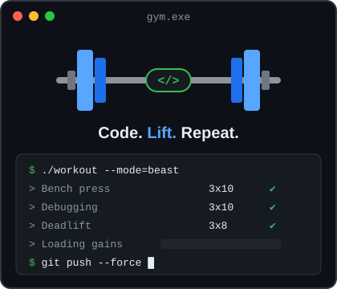

<h1 align="center">🏋️ Hello! 🏋️</h1>

<h3 align="center">I'm Luis Santos! 👋</h3>

Currently studying and improving my skills.

### About me
- 💼 IT Field Services at **Nestlé**
- 🎓 Studying Information Systems Technologies and Programming at **TechAcademy**
- 📦 Building my first apllication **AssetFlow**, an app with an integrated database for registering new equipment
- 🏋️ When I'm not coding, I'm at the gym

### 🔗 Find me here
)

### 🧰 IT Support Skills

### 📚 Currently studying

